# SkillBridge — Student Skill-Sharing & Project Collaboration Platform

A full-stack **MERN** application where students showcase their skills, share project ideas, discover teammates by skill, and collaborate on academic projects — with join-request team management and an admin moderation panel.

> Built following the *ICTAK MERN Stack Project Guidelines & Reference Guide* — every milestone in this repo maps to the guide's milestones (see [docs/testing.md](docs/testing.md) for milestone evidence).

---

## 1. Problem statement

Students struggle to find teammates for academic projects: skills, availability and interest are scattered across chat groups and notice boards, so strong students often work alone or team up by convenience instead of complementing each other.

**SkillBridge** makes skills visible and lets students propose projects, apply to each other's ideas, and form teams with an explicit accept/reject flow.

## 2. Target users

| Role | What they can do |
|---|---|
| **Student** (default role) | Create/maintain a profile (department, skills, interests), post project ideas, explore & search projects and students, send join requests, manage teams they own (accept/reject requests, remove members), edit/delete only their own content |
| **Admin** | Everything a student can do **plus**: view platform statistics, browse all users, change user roles (not their own), delete any user or project post (moderation) |

## 3. MVP scope

**Must have (this repository):**
1. Registration + login (JWT), protected routes
2. Profile management: name, department, skills, interests, bio
3. Project idea sharing: create, edit, delete **own** posts, search/filter/paginate
4. Join-request flow: apply with optional message → owner accepts/rejects → team membership
5. Team management: every project owns one team; owner can remove members
6. Find teammates: student search by skill
7. Admin panel: stats, user & project moderation, role management
8. Every screen implements **loading, success, empty and error states** (guide §7.3)

**Later (out of MVP):** chat/messaging, notifications, GitHub links, skill endorsements, email verification, dark mode.

## 4. User stories with acceptance criteria

| # | Story | Acceptance criteria |
|---|---|---|
| 1 | As a student, I want to register so that I can showcase my skills. | Registering needs name, email, password (8+ chars incl. letter+number), department. Duplicate email → 409 with a clear message. On success I land on the dashboard logged in, no manual refresh. Passwords are stored only as bcrypt hashes. |
| 2 | As a returning student, I want to log in so that my data is protected. | Wrong credentials → 401 with a generic "Invalid email or password"; correct → JWT issued (7 days). Pages under `/dashboard`, `/projects`, … redirect to `/login` when the token is missing/expired. |
| 3 | As a student, I want to keep my profile current so that teammates find me. | Only `/api/users/me` is editable, owner resolved from the token. Skills are free chips (≤ 10, each ≤ 16 chars); duplicates and >10 chips are rejected with inline messages on the client and 400 on the server. |
| 4 | As a student with an idea, I want to post a project so that others can join. | Post requires title (5–100), description (20–2000), 1–10 required skills, teammates needed 1–9. After creating, the card appears in Explore without a manual refresh. A team is auto-created with the project. |
| 5 | As a student, I want to find projects needing my skills. | Explore supports free-text search, skill filter and status filter, all paginated server-side (max page size 50). Empty result → friendly "no matches" state, not a blank page. |
| 6 | As an owner, I want to accept or reject join requests so that my team is intentional. | Only the project owner sees the requests panel and can accept/reject (403 otherwise, verified server-side). Accepting adds the requester to the team; a team never exceeds the owner+`teamSize` seats (409 when full, seats count pending requests too). Accepted requester sees the team immediately. |
| 7 | As an owner, I want to edit or delete my posts so that my board stays accurate. | Edit/delete buttons appear only for the owner (or admin); the server re-checks ownership from the token on every request. Deleting cascades: the project's team and all its join requests are removed. |
| 8 | As a student, I want to search teammates by skill so I can complement my stack. | `/students` filters by skill (case-insensitive, whole-list check) and name; students only (admins excluded). |
| 9 | As an admin, I want to moderate content and see usage stats. | Admin-only routes return 403 for students. Admin can delete any user/project, promote/demote roles except their own, and cannot delete/demote the last remaining admin. Stats show users, projects, teams, pending requests, latest signups. |
| 10 | As any user, I should never see another user's private data. | Password hashes are `select: false` and never serialized; responses use a safe user shape; ownership/authorization checks happen in controllers, not in the UI. |

## 5. Data model

Four collections, exactly as planned:

```
Users          { name, email*, passwordHash(set:false), department, role[student|admin],
                 skills[], interests[], bio, timestamps }
Projects       { title, description, requiredSkills[], teamSize(1..9),
                 status[open|in-progress|full|completed], owner→User, timestamps }
JoinRequests   { project→Project, requester→User, message?, status[pending|accepted|rejected],
                 timestamps }   // partial unique index: one PENDING request per (project, requester)
Teams          { project→Project(unique), owner→User,
                 members[{user→User, joinedAt}], timestamps }  // auto-created with every project
```

Relationship decisions (guide §6.4 — embed what is read together, reference what is shared):
- **Reference** Users everywhere (`owner`, `requester`, `members[].user`) — shared, changes independently; populated on demand.
- **Embed** the `members` array inside Team — a team is always read together with its members.
- **Indexes**: `users.email` unique, `users.skills`, `projects.requiredSkills`, `projects.status+createdAt`, `projects.owner`, `teams.project` unique, partial-unique pending join request.
- **No plain-text passwords** — bcrypt (10 rounds), hash excluded from all queries/responses by default.

## 6. Architecture (guide §3)

```
+----------------+   HTTP/JSON    +-----------------------+   Mongoose   +-----------+
|  React client  | -------------> |  Express/Node API     | -----------> |  MongoDB  |
|  (Vite, :5173) | <------------- |  (ports :5000/api)    | <----------- |           |
+----------------+                +-----------------------+              +-----------+
```

Request flow (adding a project): React validates the form → `POST /api/projects` with bearer token → Express parses JSON, verifies JWT, sanitizes NoSQL operators, runs express-validator chains → controller re-validates + inserts via Mongoose → 201 JSON, or 4xx with `{"message": …}` → React state updates the grid.

Layer responsibilities follow guide §4 (routes map only, controllers orchestrate, models own schemas, middleware handles auth/validation/errors, client keeps **all** HTTP in `services/`, shared auth state in `context/`).

## 7. Tech stack

| Layer | Technology |
|---|---|
| Database | MongoDB + Mongoose 8 |
| API | Node.js + Express 4 |
| Auth | JWT (7-day expiry) + bcryptjs password hashing |
| Client | React 18 + Vite 5 + React Router 6 |
| Tooling | Git/GitHub, Postman collection, node:test API suite, headless-Chrome screenshots |

Deliberately **no** UI framework, Redux or axios: the guide asks for a lean MVP; plain CSS design tokens, React Context and a small fetch wrapper keep the dependency tree small and the reasoning visible in README §Known limitations.

## 8. Repository layout

```
skillbridge/
├── docs/                       api-contract.md, wireframes.md, testing.md, DEPLOYMENT.md
├── client/                     React app (structure per guide §4: components/pages/services/hooks/context)
├── server/
│   └── src/
│       ├── config/             env loading + Mongo connection
│       ├── models/             Mongoose schemas (User, Project, Team, JoinRequest)
│       ├── middleware/         auth, validation, error handling, rate limiting, sanitization
│       ├── controllers/        request handling logic
│       ├── routes/             URL/method mapping only
│       ├── seeders/            demo data generator (prints random credentials)
│       └── tests/              node:test API integration suite
├── README.md
└── .gitignore
```

## 9. Screens & navigation

Landing → Login/Register → **Dashboard** · **Explore Projects** (search/filter/details) · **Project Form** · **Find Teammates** · **Students' profiles** · **My Profile** · **My Teams** (teams / requests sent / requests received) · **Admin Panel** — wireframes in [docs/wireframes.md](docs/wireframes.md), all protected screens render mobile-first with the four data states.

### Renders (captured from the running app — real data, real flows)

| | |
|---|---|
| 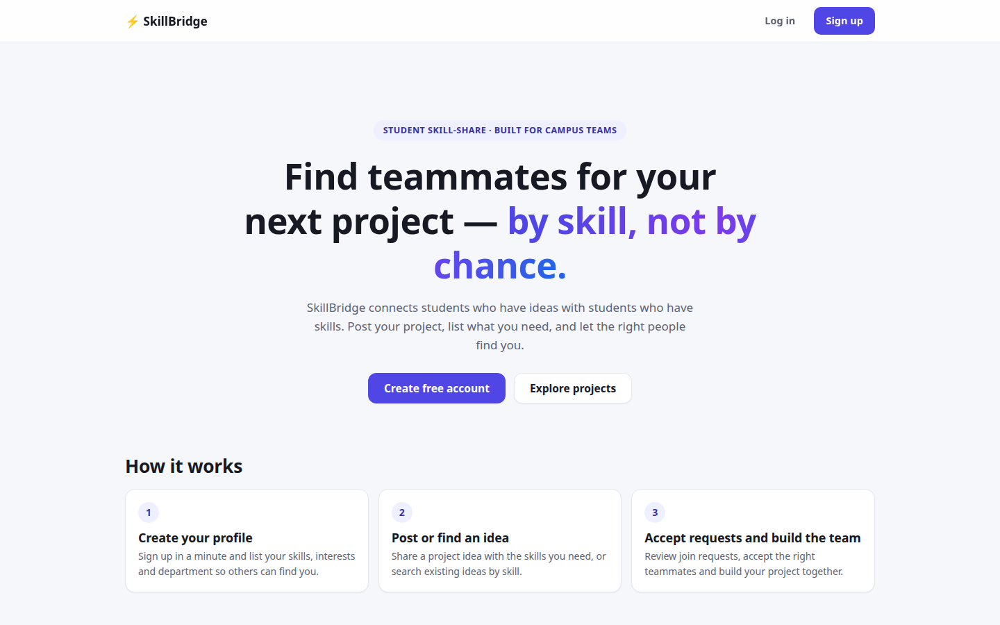 | 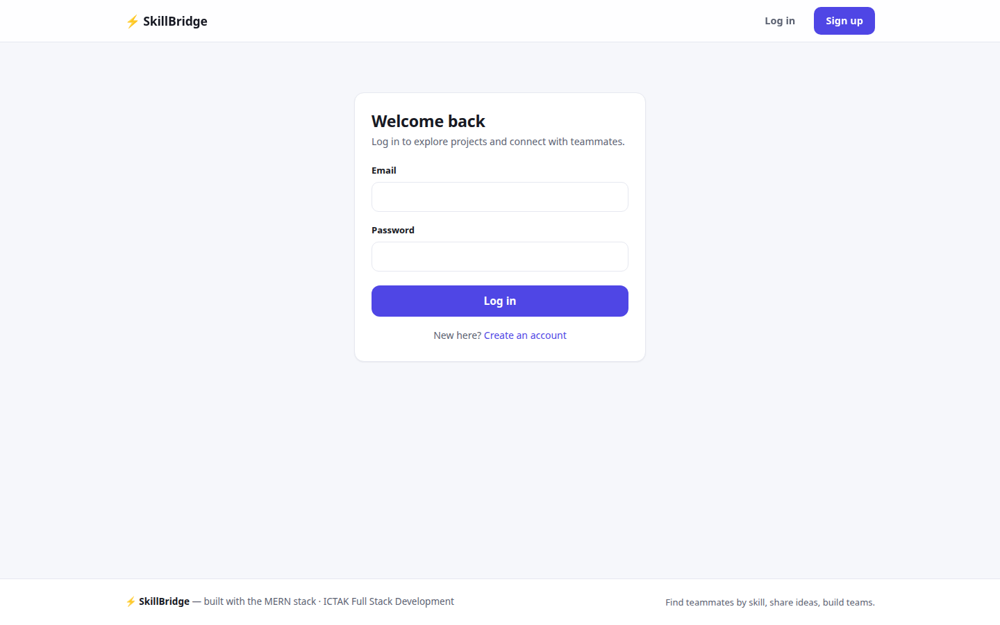 |
| 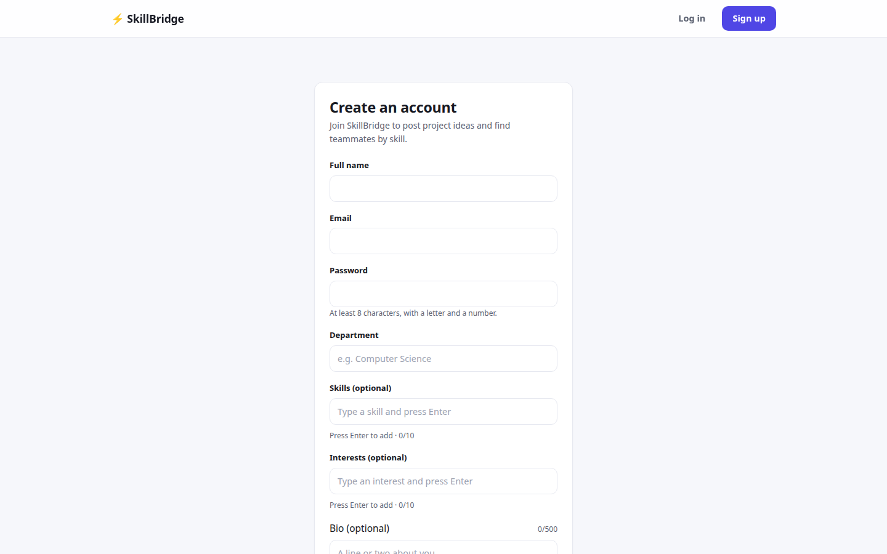 | 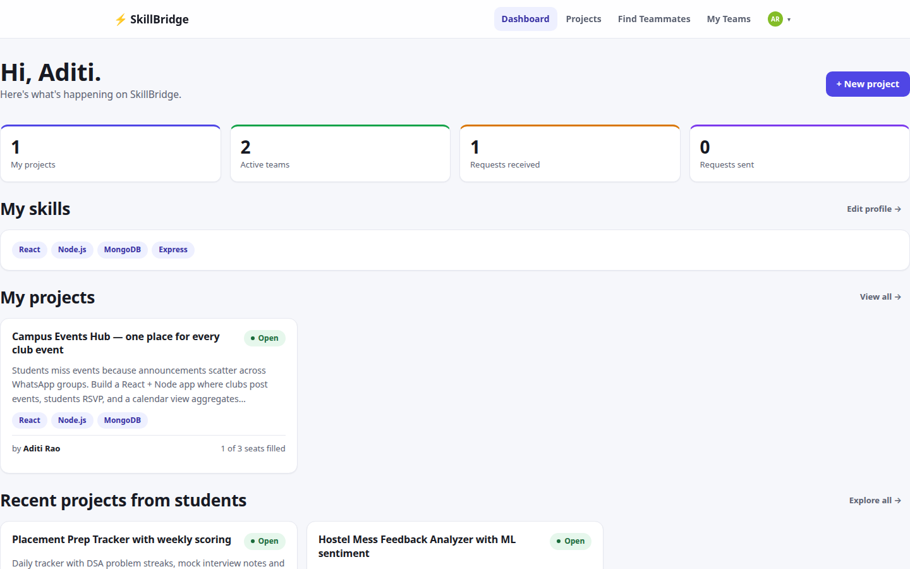 |
| 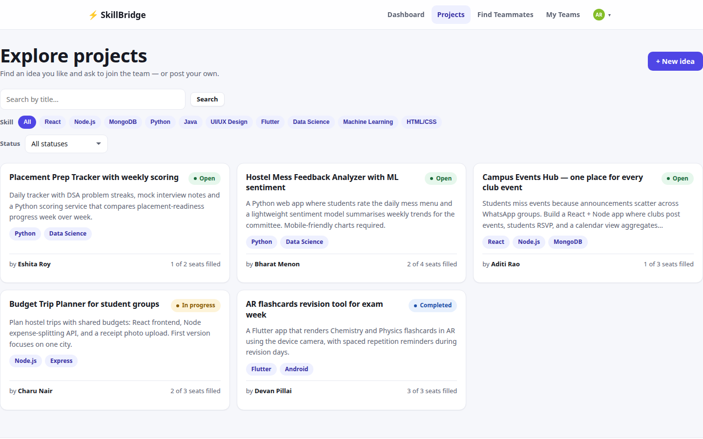 | 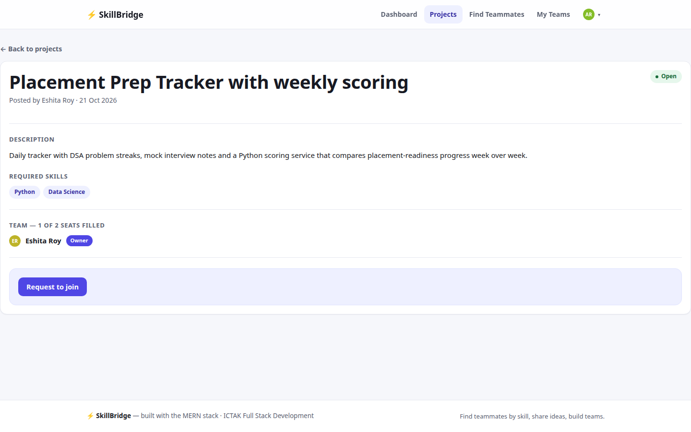 |
| 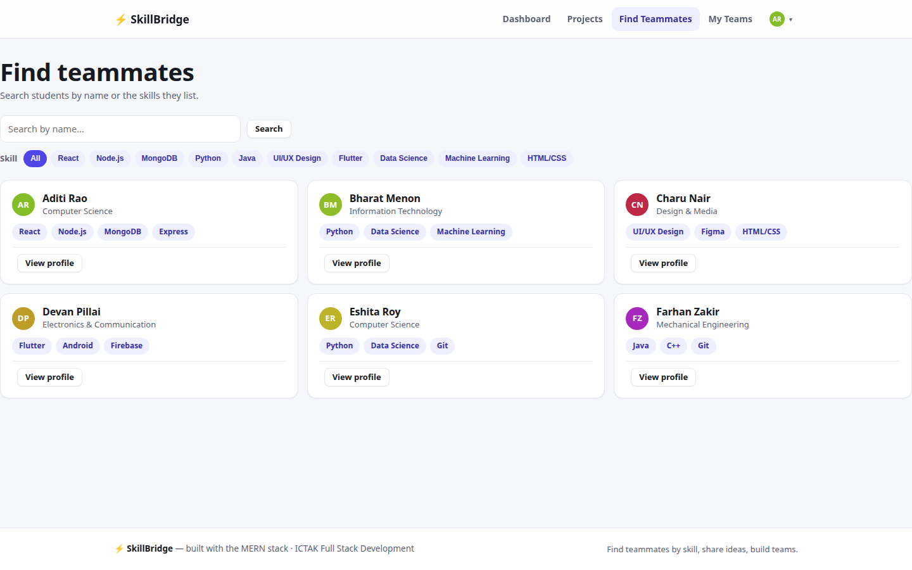 | 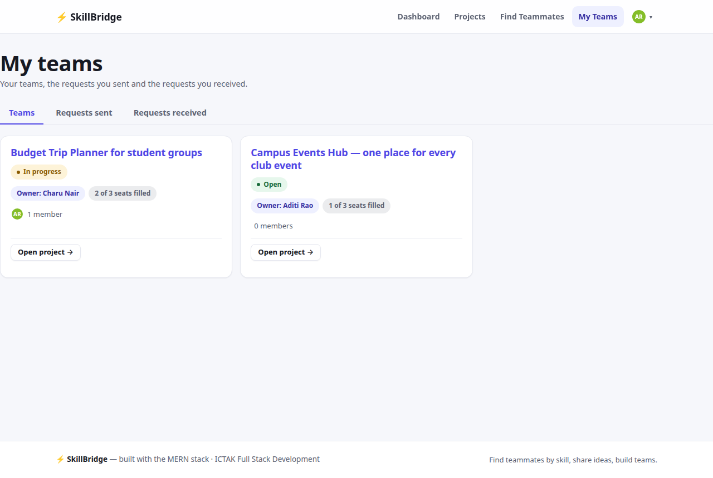 |
| 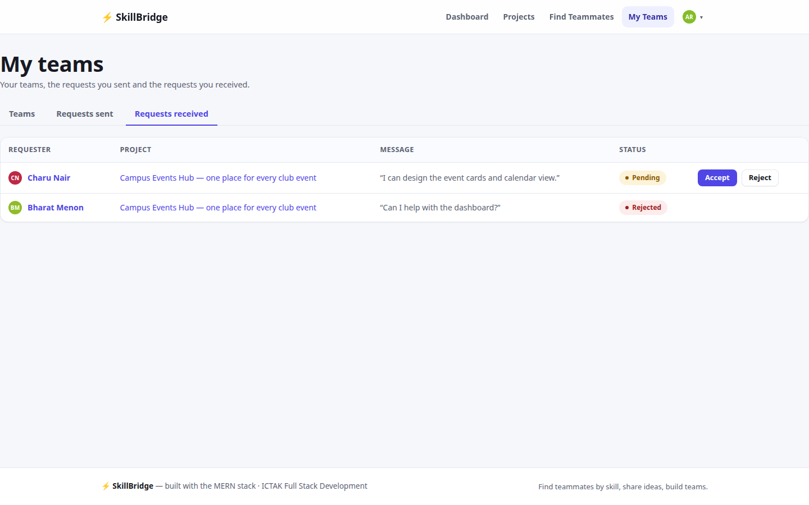 | 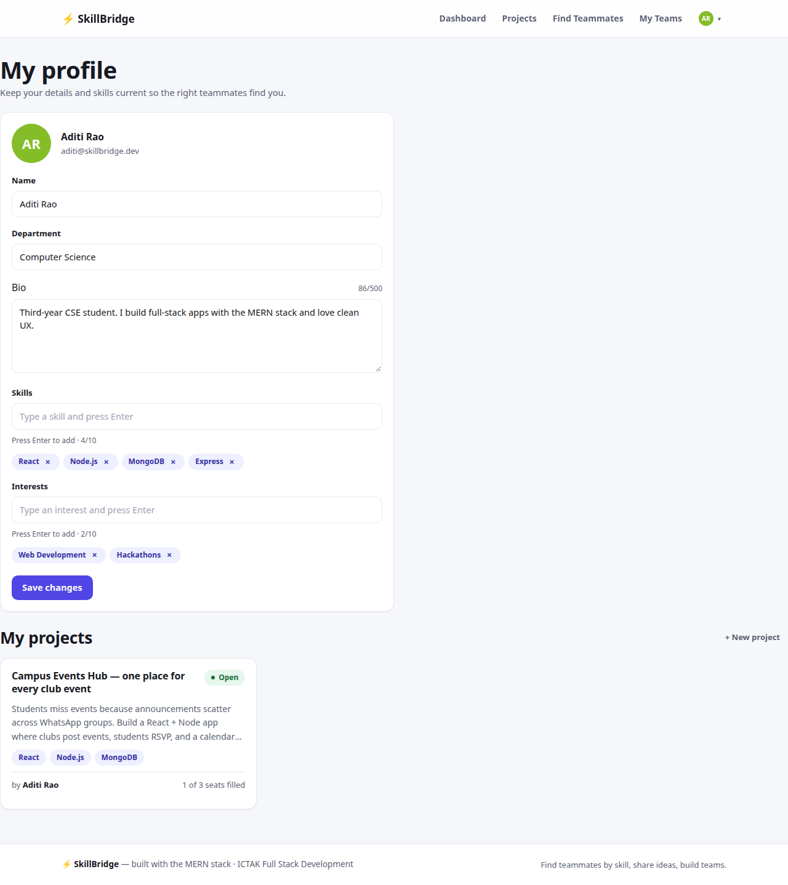 |
| 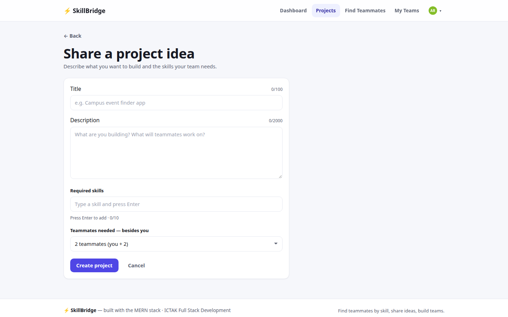 | 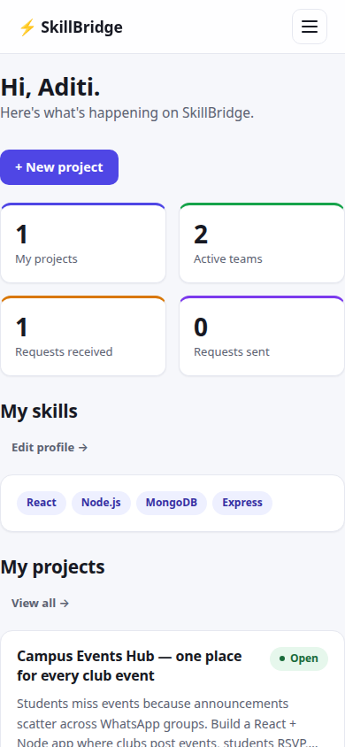 |

Admin panel: 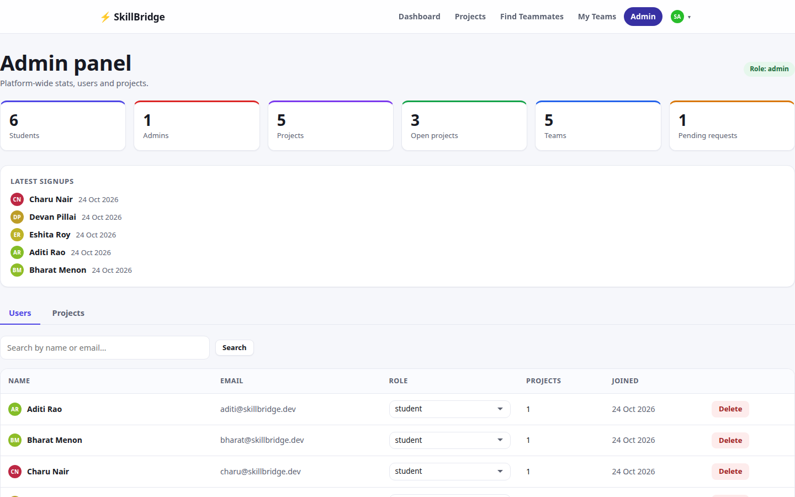

(Upper image of each pair lands at half width in the rendered README; originals are full-size PNGs in `docs/screenshots/`.)

## 10. Setup

See the [Quick start section](#quick-start) below; full environment variables in [docs/DEPLOYMENT.md](docs/DEPLOYMENT.md).

## 11. Testing

Automated API integration suite (`npm run test:api` — 41 green tests, guide §8 levels: valid/invalid input, missing auth, wrong role, ownership, cascade behavior), a Postman collection (`server/postman/`) for manual runs, and a manual UI test record + screenshots in [docs/testing.md](docs/testing.md).

### Milestone evidence map (guide §15)

| Guide milestone | Where to look |
|---|---|
| M1 Planning | README §1–6 (`docs/wireframes.md`) |
| M2–M3 Database + API structure | `server/src/{config,models,middleware}` + `docs/api-contract.md` |
| M3–M4 REST API | `server/src/{controllers,routes}` + Postman collection |
| M5–M6 React client + integration | `client/src` + `docs/testing.md` §2 screenshots |
| M7 Testing & seed | `server/src/tests` (41 tests) + `server/src/seeders` |
| M8 Deployment plan | `docs/DEPLOYMENT.md` |
| M9 Final review | this README + `docs/testing.md` §5 |

## 12. Known limitations & future improvements

Honest list (guide §13):
- JWT lives in `localStorage` (XSS trade-off) — production would use httpOnly session cookies + CSRF protection.
- Mongo must be running locally for dev; tests use an in-memory database.
- No notifications — request outcomes are visible in *My Teams → Requests sent*.
- Search is regex-based; tenfold growth would call for MongoDB Atlas Search indexes.
- One global dashboard fetch — fine at MVP scale, could be a single reactive view later.

---

## Quick start

**Option A — zero-setup (no local Mongo install required):**

```bash
git clone <this-repo> && cd skillbridge

# 1. API
cd server
cp .env.example .env          # defaults are fine for local dev (production refuses placeholder secrets)
npm install
npm run dev:mongo             # terminal 1: starts an in-memory MongoDB on :27017 (keep it open)
npm run dev                   # terminal 2: http://localhost:5000

# 2. Client (new terminal)
cd client
cp .env.example .env          # VITE_API_URL=http://localhost:5000/api
npm install
npm run dev                   # http://localhost:5173
```

**Option B — own MongoDB:** point `MONGODB_URI` at a local `mongod` or Atlas cluster, skip `dev:mongo`, otherwise identical.

> `npm run seed` (run once from `server/`) loads five demo students + one admin
> (`admin@skillbridge.dev`) with teams, projects and a pending join request. It **prints a
> random password in the console** (never committed) — use it for every demo account.
> For a clean slate for real users, skip seeding entirely.

| App | Folder | Command | URL |
|---|---|---|---|
| React client | `client/` | `npm run dev` | http://localhost:5173 |
| Express API | `server/` | `npm run dev` | http://localhost:5000 |
| API tests | `server/` | `npm run test:api` | (spins up in-memory Mongo) |
| Seed demo data | `server/` | `npm run seed` | prints credentials |

Environment variable names are documented in `client/.env.example` and `server/.env.example`; real `.env` files are git-ignored.
